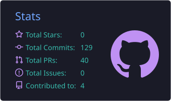
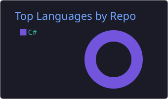

# Hi, I'm Prahelika Dutta 👋

**Software Developer · ASP.NET Core & Unity · Pune, India**

---

### 🧑‍💻 About Me

I'm a software developer with ~3 years of experience in two worlds that share one language, **C#**: web and desktop applications with **ASP.NET Core**, and augmented reality apps with **Unity**. I've delivered projects for international clients in the US and Austria.

<table>
<tr>
<td width="50%" valign="top">

#### 🌐 ASP.NET Core & .NET
- Web apps and REST APIs with **ASP.NET Core**
- Integrations: SSO (Keycloak), payment gateways, third-party APIs
- Migrating legacy **ASP.NET MVC** apps to .NET Core
- Desktop engineering tools with **WinForms**
- Databases: **SQL Server**, **MySQL**, **Oracle**

</td>
<td width="50%" valign="top">

#### 🥽 Unity & AR
- AR apps with **Unity**, **AR Foundation** and **Vuforia**
- Image tracking and interactive 3D experiences
- Field-survey AR app for iOS
- Building toward **XR / immersive technology**

</td>
</tr>
</table>

🌱 **Currently learning:** Azure · automated testing (xUnit / Moq) · CI/CD with GitHub Actions

---

### 🚀 Featured Project

#### [Prahelika.Calculators](https://github.com/PD0704/Prahelika.Calculators)

A C# calculator library published on NuGet (basic, scientific, finance and more), with an ASP.NET Core API and web UI. Built with unit tests, CI/CD on GitHub Actions and versioned releases.

---

### 🛠️ Tech Stack

  
   
  

Also: ASP.NET Core · ASP.NET MVC · WinForms · SQL Server · Oracle · AR Foundation · Vuforia

---

### 📊 GitHub Stats

  
  
   
  

---

### ✍️ Random Dev Quote

  

---

### 🤝 Let's Connect

  
  
  

  

